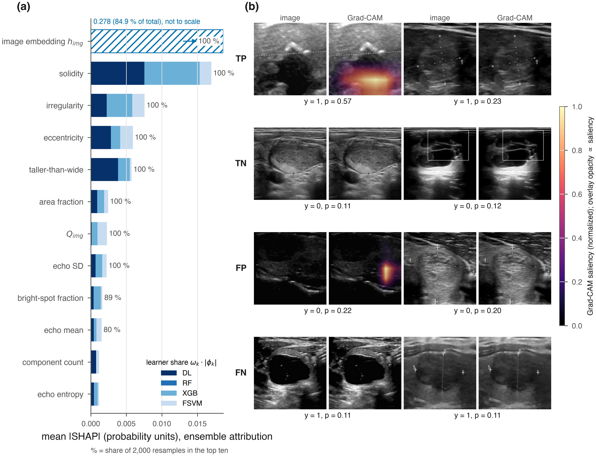

# TAMES AI — reference implementation on TN3K

Code for the revised manuscript *TAMES AI: An Adaptive Fuzzy, Multimodal Ensemble Model for
Malignancy Risk Assessment of Thyroid Nodules*. Every equation of Section 3 maps to one
function (table below). PyTorch for the image branch; scikit-learn / XGBoost for the rest.

**Status.** The full experiment (`configs/default.yaml`, ImageNet-initialized backbone, seeds 0–4)
was run on 2026-10-14; its outputs are under `runs/tn3k_fold0/` (expert delineation),
`runs/tn3k_automask/` (fully automatic), `runs/tn3k_frac*/` (low data) and
`runs/tn3k_fold0/robustness/`. The manuscript, supplementary material and figures built from
those outputs are in `paper/`. An earlier run with a randomly initialized backbone is kept
under `runs/scratch_*/` for reference only; nothing in the paper uses it.

## What the experiment is

* **Data.** TN3K (Gong et al., 2021/2022): 2,879 train/val + 614 test B-mode images with
  radiologist nodule masks and benign/malignant labels. Official fold-0 train (2,303) /
  val (576) split and the official test set. TN3K has no patient IDs → image-level split
  (state this in Limitations). No laboratory, clinical or regional variables exist in
  TN3K, so the **structured modality is a set of TI-RADS-like descriptors** computed from the
  image and the nodule delineation (`tames/features/descriptors.py`); the laboratory and
  regional branches of the paper remain untested here (Δ_reg = 0).
* **Model.** Eqs. (1)–(16) of the manuscript, see the map below.
* **Baselines.** image-only CNN, structured-only XGBoost, CNN + XGBoost late fusion, each
  learner alone. (TI-RADS-alone is not possible: TN3K has no TI-RADS category.)
* **Statistics.** 2,000-resample bootstrap CIs, DeLong, exact McNemar, Holm correction,
  calibration (Brier, slope, intercept), seed-to-seed SD, ablation (a)–(f), SHAP + Grad-CAM
  with deletion/insertion faithfulness and rank stability.

## Setup (macOS / Linux)

```bash
cd tames
python -m venv .venv && source .venv/bin/activate
pip install -r requirements.txt
brew install unar libomp       # macOS (apt install unrar on Debian/Ubuntu); libomp is needed by XGBoost
bash scripts/00_download_tn3k.sh
python -m pytest tests -q     # 11 range/reduction checks of the fuzzy equations
```

Apple-Silicon Macs use the MPS backend automatically (`device: auto`).

## Run

```bash
bash scripts/run_all.sh configs/quick.yaml     # smoke test, minutes on CPU
bash scripts/run_all.sh                        # full run, seeds 0–4
```

Or step by step (`--set key=value` overrides any config entry):

| Step | Script | Produces (under `runs/<run_name>/`) |
|---|---|---|
| 1 | `01_prepare_data.py` | `data/processed/splits.csv`, `snr0.json` (SNR₀, Eq. 3) |
| 2 | `02_fuzzy_preprocess.py` | tuned α, β, γ, λ (`fuzzy_params.json`), crops `X_*.npy` with channels [x̃, μ, F, F_plain], descriptors + per-image Dice in `meta_*.csv` |
| 3 | `03_train_cnn.py --variant tames\|image_only` | `cnn_<variant>_seed<k>/` embeddings h_img and p_DL, `model.pt`, training history |
| 4 | `04_train_learners.py` | `learners_tames_seed<k>/` RF, XGB, FSVM, structured-only XGB probabilities, z, selected hyperparameters |
| 5 | `05_ensemble_eval.py` | `ensemble_tames_seed0/results.json`, `results_table.csv` (Table 3), comparisons (DeLong, McNemar, Holm), calibration |
| 6 | `06_ablation.py` | `ablation_table.csv` (Table 4) |
| 7 | `07_explain.py` | `explain_tames_seed0/` SHAP summary + stability, Grad-CAM panel, faithfulness |
| 9–10 | `09_lowdata.sh`, `10_lowdata_table.py` | low-data experiment: TAMES vs image-only CNN retrained on 10/25/50 % of the training partition (`train_frac`), `runs/lowdata_table.csv`, `lowdata.png` |
| 11 | `11_predict.py --image img.jpg [--mask mask.png] [--cam out.png]` | inference on one image with the trained models: per-learner and ensemble probabilities per seed, seed-averaged p_final and label at t*, optional Grad-CAM overlay; without `--mask` the automatic-delineation models are used |
| 12 | `12_demo_export.py` | `demo/tames_walkthrough.html`: animated walkthrough of six test images (TN, FP, TP, FN) through every pipeline stage, expert and automatic delineation |
| 13 | `13_demo_server.py [--port 8765]` | live walkthrough UI on localhost: upload an image (and optionally a mask) and watch the same stages computed by the trained models |
| 8 | `08_robustness.py` (optional, after 3–5) | `robustness/` AUC of TAMES vs image-only CNN and late fusion under noise, speckle, blur and contrast loss applied to the raw test images (front end recomputed, models frozen); `robustness.png` |

## Results (official TN3K test set, 614 images, predictions pooled over 5 seeds)


| Model | Expert delineation, AUC [95 % CI] | Automatic delineation, AUC [95 % CI] |
|---|---|---|
| TAMES AI | 0.815 [0.779, 0.848] | 0.823 [0.787, 0.855] |
| Image-only CNN | 0.830 [0.794, 0.861] | 0.805 [0.770, 0.839] |
| CNN + XGBoost late fusion | 0.802 [0.767, 0.837] | 0.785 [0.747, 0.820] |
| Descriptor-only XGBoost | 0.684 [0.644, 0.728] | 0.588 [0.539, 0.631] |

With the radiologist delineation available, TAMES AI does not outperform the image-only CNN
(ΔAUC −0.015, DeLong p = 0.10). With the crop and the descriptors derived automatically from the
fuzzy map, it is ahead of the image-only CNN (ΔAUC +0.017, p = 0.09, Holm p = 0.36) and of the
late fusion (ΔAUC +0.038, p = 0.002, Holm p = 0.01). The ensemble gives the best-calibrated
probabilities (slope 1.07, intercept 0.16). Under image degradation TAMES AI loses more AUC than
the baselines (mean drop 0.091 vs 0.034 for the image-only CNN), and at 10–50 % of the training
images it is level with the image-only CNN. Full tables: `runs/tn3k_fold0/ensemble_tames_seed0/results_table.csv`,
`ablation_table.csv`, `robustness/robustness.csv`, `runs/lowdata_table.csv`.

| ROC curves (a: expert, b: automatic) | Robustness to image degradation |
|---|---|
|  |  |



All figures are produced from saved outputs by `scripts/plots/` (see `paper/figures/README.md`):
image flow, architecture, dataset samples through the fuzzy front end, ROC, robustness, low-data,
calibration, explanations, and a supplementary per-seed figure.

## Equation → code map

| Eq. | Content | Code |
|---|---|---|
| (1) | min–max normalization | `tames/fuzzy/atcfm.py: normalize` |
| (2) | local mean / SD over W_p | `local_stats` |
| (3) | T (entropy), K (Michelson), q from Immerkær SNR | `local_entropy`, `local_contrast`, `immerkaer_noise`, `snr`, `quality_coefficient` |
| (4) | ATCFM membership μ | `atcfm` |
| (5) | adaptive radius r(p) | `tames/fuzzy/afmo.py: structuring_radius` |
| (6) | reliability weight w(p) | `reliability_weight` |
| (7) | weighted erosion / dilation | `weighted_erosion`, `weighted_dilation` |
| (8) | opening, closing, F = λO + (1−λ)C | `afmo` |
| (9) | h_img = f_θ([x̃, F]) | `tames/models/cnn.py: NoduleCNN.embedding` |
| (10) | Q_m from observation indicators | `tames/features/fusion.py: quality_from_indicators` |
| (11) | z concatenation | `fuse`, `NoduleCNN.fused` |
| (12)–(13) | Fuzzy SVM, sample membership s_n | `tames/models/fsvm.py` |
| (14) | ω_k = softmax(−L_k^val/τ) | `tames/models/ensemble.py: adaptive_weights`, `select_tau` |
| (15) | Δ_reg prior shift | `regional_prior_shift` |
| (16) | p_final, threshold t* | `final_probability`, `choose_threshold` |
| 3.11 | SHAP, Grad-CAM, faithfulness | `scripts/07_explain.py` |
| 3.12 | bootstrap, DeLong, McNemar, Holm, calibration | `tames/eval/` |
| robustness | degradation curves (quality-robustness experiment) | `tames/robustness.py` |

## Design decisions you should know (and state in the paper)

1. **Structured features come from the dataset masks** (`image.mask_source: gt`), i.e. the
   radiologist's delineation is an input, as in TI-RADS-descriptor models. Set
   `mask_source: afmo` to use the model's own Otsu-binarized F instead (fully automatic,
   weaker descriptors).
2. **Embeddings for the training rows are in-sample** (one final CNN per seed). The earlier
   "out-of-fold embeddings" idea was dropped because embeddings from different fold
   models live in different coordinate systems and cannot be mixed with the final model's;
   the manuscript sentence in 3.6 must say this. The downstream learners are tuned on
   validation only and the test set is scored once.
3. **α, β, γ, λ and the Otsu polarity are selected by Dice** on a validation subset
   (`fuzzy.tune_subset`). F is a homogeneity/boundary map, not a segmenter: expect a modest
   Dice (whole-image Otsu, no post-processing). Report it as a segmentation-stage result only.
4. **τ is selected on validation by ensemble log-loss**; the learner weights themselves come
   from validation log-loss (Eq. 14). Report both.
5. **t\*** = sensitivity ≥ 0.95 with maximal specificity on validation (`ensemble.min_sensitivity`);
   the Youden threshold is also reported.
6. **Labels.** `data/labels/*.csv` were rebuilt from the CC-BY-4.0 manifest of
   b-kiani/Case-level-audit…, which lists the ACL-release labels (0 benign, 1 malignant).
   Download the official `label4trainval.csv` / `label4test.csv` from the ACL repository
   (Google Drive / Baidu) and run `python scripts/01_prepare_data.py --verify-labels <dir>`
   before publishing. Cite Gong et al. ISBI 2021, CBM 2022 (images) and MICCAI 2022 (labels).
7. **Automatic-mask variant.** `--set image.mask_source=afmo paths.processed=data/processed_afmo run_name=tn3k_automask` re-runs steps 2–5 with the crop and the descriptors taken from the Otsu-binarized AFMO map instead of the radiologist mask (fully automatic pipeline).
8. **External validation.** DDTI (Pedraza et al., 2015) is the natural external set
   (2 Toshiba scanners, XML annotations). It is not wired in yet; add a loader under
   `tames/data/ddti.py` producing the same `splits.csv` columns and re-use steps 2–5 with
   `--set paths.processed=data/processed_ddti`.

## Filling the manuscript

* Table 1/2 (cohort) → `data/processed/splits.csv`, `meta_*.csv` (counts, label fractions, image sizes).
* Table 3 → `runs/tn3k_fold0/ensemble_tames_seed0/results_table.csv`; DeLong/McNemar/Holm in `results.json → comparisons_vs_tames`.
* Table 4 → `runs/tn3k_fold0/ablation_table.csv`.
* Supplementary S2 (hyperparameters) → `fuzzy_params.json`, `learner_params.json`, `cnn_results.json`.
* Figures 1–8 and S1 → `python scripts/plots/fig*.py` (outputs in `paper/figures/`, inputs listed in `paper/figures/README.md`).
* Word/PDF submission files → `python paper/word/build_word.py` (needs pandoc and python-docx).

## Layout

```
tames/            package: fuzzy/ (Eqs 1–8), features/ (9–11 inputs), models/ (9, 12–16), eval/, pipeline.py
scripts/          00 download · 01 prepare · 02 fuzzy · 03 cnn · 04 learners · 05 ensemble · 06 ablation · 07 explain · 08 robustness · 09–10 low data
scripts/plots/    figure scripts (one per figure) + shared style modules
configs/          default.yaml (full), quick.yaml (smoke test)
data/labels/      TN3K labels (see 6 above);  data/raw/ and data/processed*/ are generated
tests/            pytest range/reduction checks
runs/             outputs (tables, JSON and figures are versioned; arrays, weights and logs are not)
paper/            manuscript_v3.md, supplementary.md, cover letter, figures/, word/ (build script and submission files)
```
