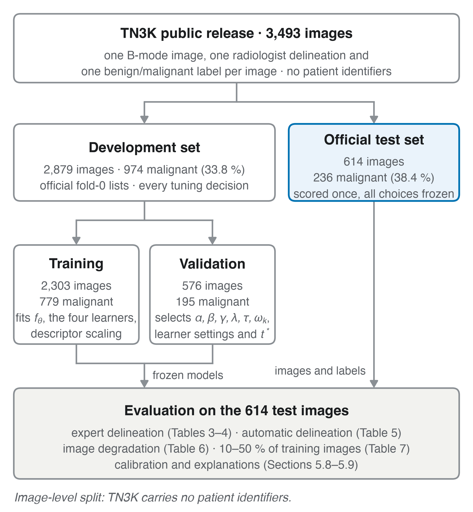
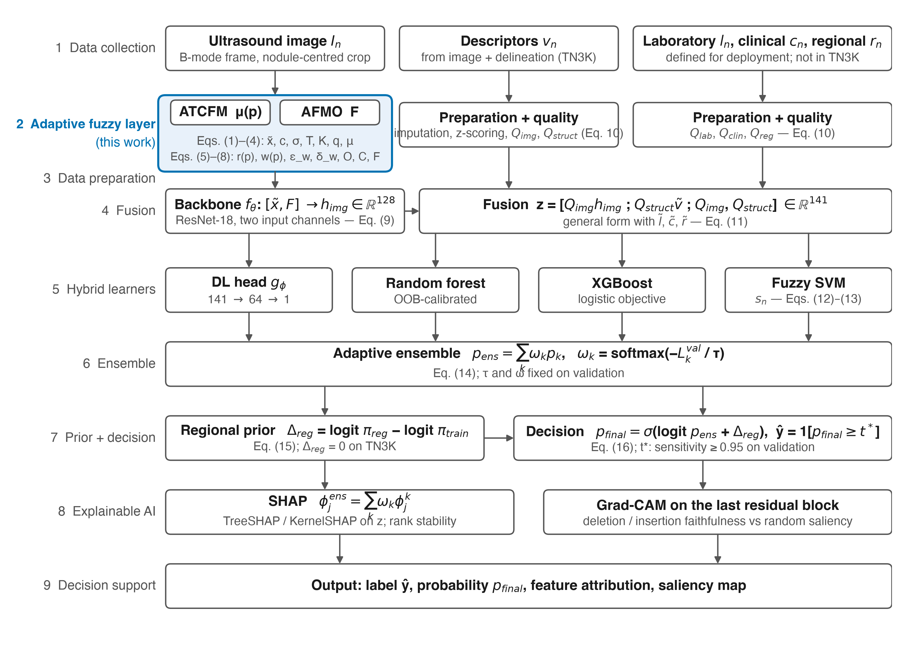
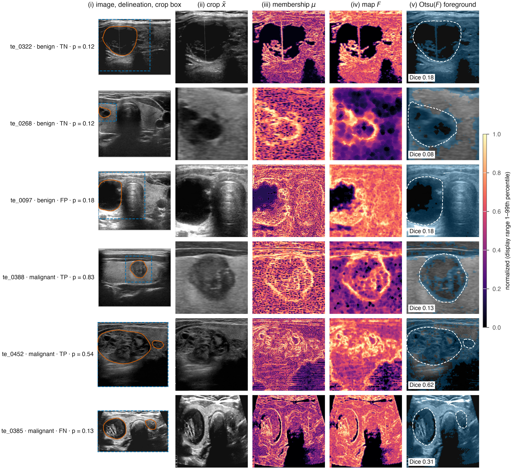
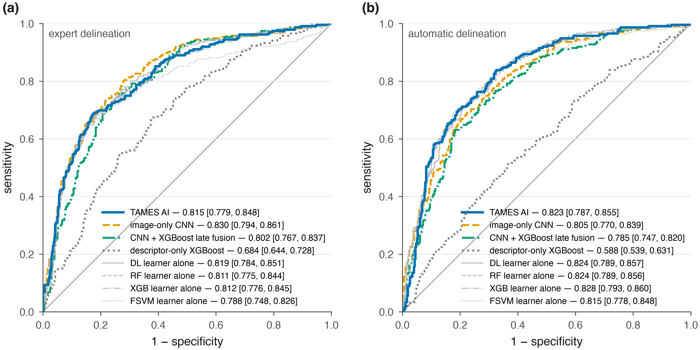
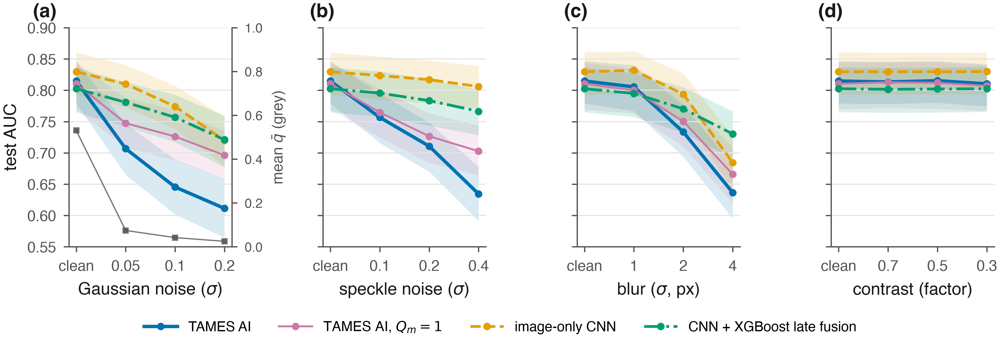
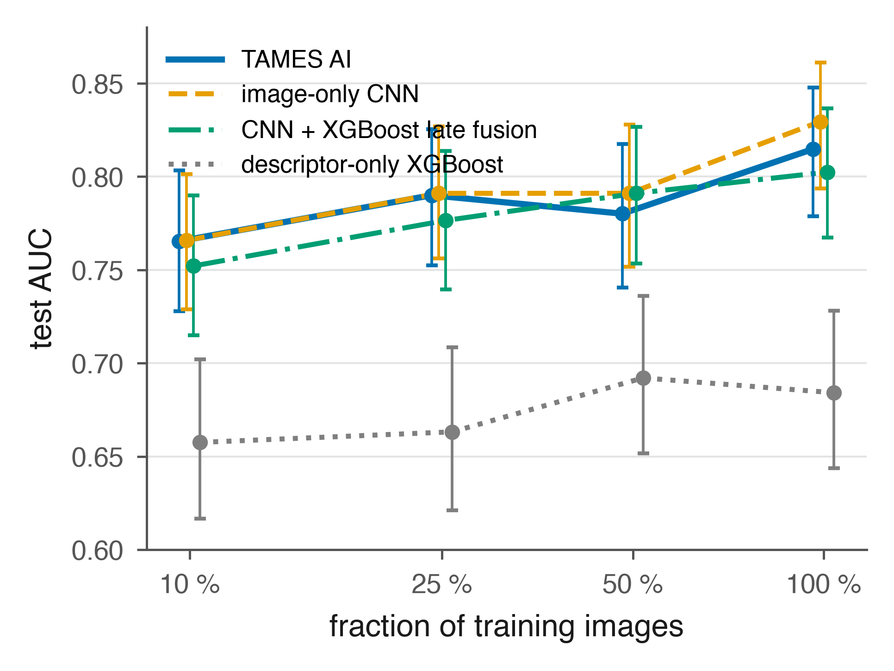
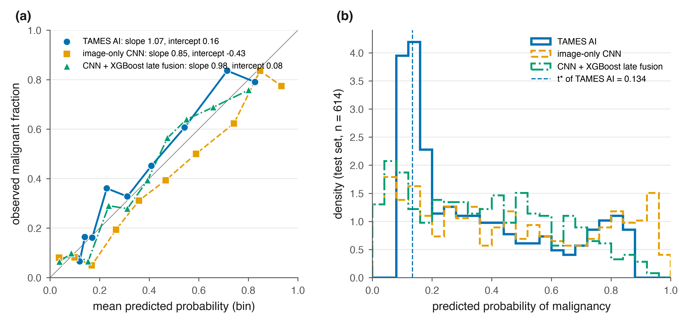
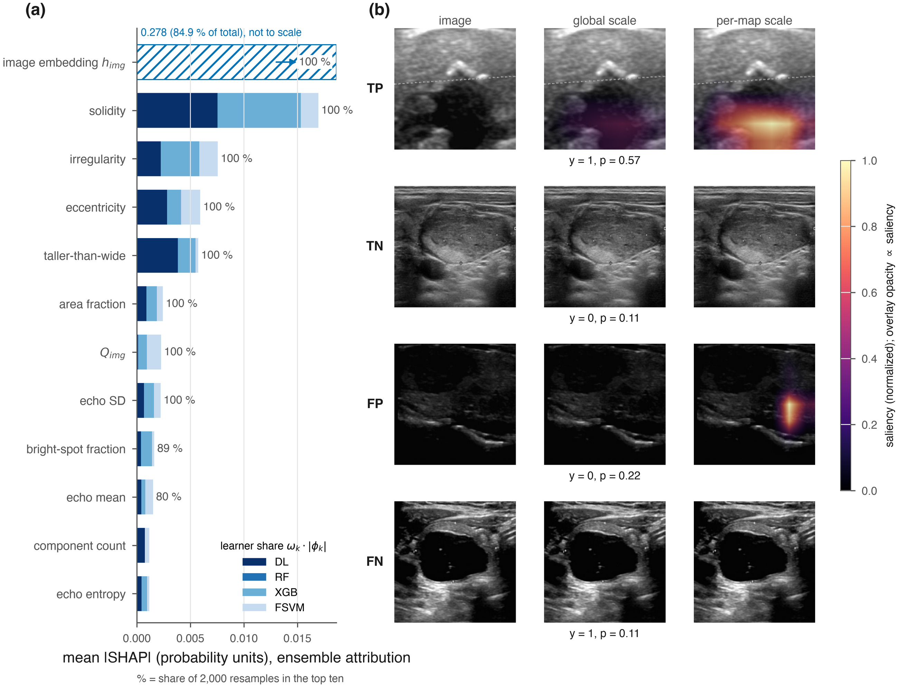

**Article type:** Research Article

**Authors:** N. N. Zufarova¹, M. A. Mirzayev²

¹ Muhammad al-Khwarizmi Tashkent University of Information Technologies, Tashkent, Uzbekistan ² Tashkent State University of Economics, Tashkent, Uzbekistan

**Corresponding author:** \[\[name, e-mail, ORCID\]\]

# Abstract

**Background.** Malignancy risk stratification of thyroid nodules rests on ultrasound features that are graded, observer-dependent and acquired under variable image quality, and in Central Asia it is further shaped by iodine deficiency. We propose TAMES AI (Thyroid AI Malignancy Evaluation System), a clinical decision-support framework that represents this uncertainty explicitly, from the pixel level to the final decision, with adaptive fuzzy set theory and a hybrid machine-learning ensemble, and we evaluate the part of the framework that a public dataset allows.

**Methods.** The model was developed and tested on the public TN3K dataset (3,493 B-mode ultrasound images with radiologist nodule masks and benign/malignant labels; official split: 2,303 training, 576 validation, 614 test images). Images were processed with an adaptive texture–contrast fuzzy membership function and reliability-weighted fuzzy morphological operations; a ResNet-18 embedding of the image and the fuzzy map was fused with eleven sonographic descriptors computed from the nodule delineation, each modality weighted by a data-quality coefficient; four learners (deep network, random forest, XGBoost, fuzzy SVM) were combined with validation-loss-dependent weights. Laboratory, clinical and regional inputs are defined by the framework but are not available in TN3K and were not evaluated. Comparators were an image-only CNN, a descriptor-only XGBoost and a CNN + XGBoost late fusion, under a pre-specified plan (DeLong, exact McNemar, Holm correction, 2,000-resample bootstrap intervals, five seeds). Three further experiments tested the framework where its assumptions matter: inference without the expert mask (fully automatic delineation by the fuzzy map), synthetic image degradation, and reduced training data.

**Results.** With the expert delineation, TAMES AI reached a test AUC of 0.815 \[95 % CI 0.779–0.848\], not better than the image-only CNN (0.830 \[0.794–0.861\]; DeLong p = 0.10) or the late fusion (0.802 \[0.767–0.837\]; p = 0.24), and no component changed the AUC by more than 0.014 in ablation. Without the expert delineation, TAMES AI kept its accuracy (0.823 \[0.787–0.855\]) while the image-only CNN fell to 0.805 \[0.770–0.839\] (p = 0.09) and the late fusion to 0.785 \[0.747–0.820\] (p = 0.002, Holm-corrected 0.010). Under synthetic noise, blur and contrast loss, TAMES AI lost the most AUC of all models (mean drop 0.091 vs 0.034 for the image-only CNN); removing the quality coefficients reduced the drop to 0.059. With 10–50 % of the training data no model held an advantage. TAMES AI was the best-calibrated model (slope 1.07, intercept 0.16). The fuzzy map improved nodule segmentation over Otsu thresholding (Dice 0.201 vs 0.120), the SHAP ranking was stable across resamples, and Grad-CAM maps were more faithful than a random control on insertion but not on deletion.

**Conclusions.** On clean images with an expert delineation, explicit uncertainty modelling adds nothing a convolutional network does not already learn. Its accuracy, unlike the network's, did not depend on an expert delineation, and it was better calibrated; but multiplicative quality gating and the fuzzy channel itself are liabilities under heavy noise. The framework is released as reproducible code; its laboratory, clinical and regional branches await evaluation on clinical cohorts.

**Keywords:** thyroid nodule; thyroid cancer; ultrasound; adaptive fuzzy set theory; fuzzy morphology; multimodal learning; ensemble learning; explainable artificial intelligence; clinical decision support.

# 1. Introduction

Thyroid nodules are common, and only a small fraction are malignant; the clinical task is to find that fraction without operating on the rest. Current practice relies on ultrasonography graded with the ACR TI-RADS lexicon, laboratory testing, and fine-needle aspiration cytology reported in the Bethesda system \[1–3\]. Each step carries uncertainty. Ultrasound features such as margin irregularity or echogenicity are judged by eye and vary between readers; laboratory values fluctuate; and cytology returns an indeterminate result (Bethesda III–IV) in roughly a fifth of aspirates, a group in which the malignancy rate is too high to ignore and too low to justify surgery for all \[3\]. The consequences are diagnostic surgery for benign disease on one side and delayed cancer diagnosis on the other.

Artificial intelligence has been applied to this problem with promising results. Convolutional networks trained on B-mode images classify nodules with accuracy approaching that of experienced radiologists in meta-analyses \[4–6\]. Three limitations persist. First, most systems use imaging alone and ignore the laboratory and clinical context that the physician has in hand. Second, they treat every input as crisp, although the underlying observations are graded and uncertain; fuzzy set theory offers a mathematical language for exactly this situation \[7\], but its combination with modern multimodal learning remains little explored. Third, models developed on European, North American or East Asian cohorts have not been shown to transfer to Central Asia, where iodine deficiency and regional epidemiology alter both the prevalence and the sonographic appearance of thyroid disease. Explainability adds a fourth requirement: a probability without a rationale is difficult for a clinician to act on, and post-hoc attribution methods such as SHAP and Grad-CAM are now expected in clinical AI reporting \[8, 9\].

This study addresses these limitations with TAMES AI (Thyroid AI Malignancy Evaluation System). The framework (i) represents pixel-level uncertainty with an adaptive texture–contrast fuzzy membership function and reliability-weighted fuzzy morphological operations; (ii) fuses the image embedding with structured inputs, each weighted by an explicit data-quality coefficient; (iii) combines a deep network, a random forest, gradient-boosted trees and a fuzzy support vector machine through validation-loss-dependent ensemble weights; (iv) admits regional prevalence as a Bayesian prior-shift correction; and (v) delivers SHAP and Grad-CAM explanations whose faithfulness is itself measured.

The aim was to evaluate the part of this framework that a public dataset allows, under a pre-specified and fully reproducible protocol. On TN3K \[35–37\], the largest public thyroid ultrasound dataset with nodule delineations and malignancy labels, we instantiate the structured branch with sonographic descriptors computed from the delineation (no laboratory, clinical or regional variables exist in TN3K) and ask four questions: whether the uncertainty-aware model outperforms an image-only network and a conventional late fusion when an expert delineation is available; whether it does so when the delineation is produced automatically by the fuzzy map; how it behaves under degraded image quality; and how it behaves with little training data. The study is reported according to TRIPOD+AI and CLAIM.

# 2. Related Work and Research Gap

**Imaging-based deep learning.** Convolutional networks \[10\] and residual architectures \[11\] have been trained to classify thyroid nodules from B-mode ultrasound, and encoder–decoder networks derived from U-Net \[12\] to segment them. A model built on ACR TI-RADS descriptors matched radiologist performance in a large single-center series \[13\], and evolutionary encoder–decoder designs have improved nodule segmentation \[14\]. Pooled analyses report AUC values above 0.90 for image-only classifiers \[4–6\], but performance drops when models are applied to other scanners or populations, and a recent two-center external validation documented this gap \[15\].

**Structured machine learning.** Random forests \[16\], gradient-boosted trees \[17\], support vector machines and logistic regression have been applied to clinical, laboratory and sonographic descriptors, and a 2025 meta-analysis found that models built on ultrasound characteristics alone are competitive with image-based networks \[18\]. These methods use the full clinical record but treat ordinal and graded inputs as crisp values. The fuzzy support vector machine \[19\] relaxes this by attaching a membership to every training sample, yet it has rarely been used in thyroid diagnosis.

**Fuzzy and uncertainty-aware approaches.** Fuzzy set theory \[7\] models linguistic categories such as "mildly hypoechoic" directly. Adaptive membership functions, whose parameters follow the local statistics of the data, extend this to image preprocessing. Uncertainty-aware multimodal deep networks have recently been proposed for thyroid ultrasound \[20\], but a model that carries uncertainty from the pixel level through feature fusion to the final decision has not been reported.

**Multimodal fusion.** Combining deep image features with clinical variables improves prediction over either source alone \[21, 22\]. Most published fusions are late fusions of two models; few weight each modality by its measured quality or handle missing laboratory values explicitly.

**Explainability and reporting.** SHAP \[8\] and Grad-CAM \[9\] are the dominant attribution methods in clinical AI; regulators expect them in software-as-a-medical-device submissions \[23\], and reporting guidelines for prediction models \[24\] and imaging AI \[25\] now require that explanation quality be evaluated rather than assumed.

| Approach family | Inputs | Uncertainty handling | Regional adaptation | Explainability | Representative work |
| ---------------------------- | ---------------------------- | ---------------------------- | ---------------------------- | ---------------------------- | --------------------- |
| Image-only CNN | ultrasound | none | none | Grad-CAM, sometimes | \[4–6, 11, 13\] |
| Structured ML | clinical, laboratory, descriptors | none | none | feature importance | \[16–18\] |
| Fuzzy SVM | structured | sample membership | none | none | \[19\] |
| Late multimodal fusion | image + clinical | none | none | SHAP on tabular part | \[21, 22\] |
| Uncertainty-aware multimodal DL | image + clinical | evidential or Bayesian output | none | attention maps | \[20\] |
| TAMES AI (this work) | image, laboratory, clinical, regional | pixel membership, quality coefficients, sample membership, prior shift | iodine index, regional prevalence | SHAP + Grad-CAM with faithfulness tests | — |

**Research gap.** No published model combines adaptive fuzzy image processing, quality-weighted multimodal fusion, an uncertainty-aware ensemble and regional epidemiological correction in one architecture, and none has been developed and externally validated on Central Asian data. TAMES AI is designed to fill that gap.

# 3. Materials and Methods

# 3.1 Study design and reporting

This is a retrospective model development and evaluation study on a public dataset, reported according to TRIPOD+AI \[24\] and CLAIM \[25\]; completed checklists are given in Supplementary S1. The unit of analysis is the ultrasound image, each showing one delineated nodule. The reference standard is the benign/malignant label released with the dataset by its authors \[37\]; TN3K does not document the cytological or histological basis of each label, which is stated as a limitation (Section 6). The data are public and de-identified, so no ethics approval or consent was required; the dataset was used under the terms of its release and is cited accordingly. Figure 1 shows the image flow.

{width=85mm}

**Figure 1.** Flow of the 3,493 TN3K images through the study. The official fold-0 lists fix the training (2,303 images) and validation (576) partitions; every tuning decision is made on validation; the official test set (614) is scored once with all choices frozen. The split is image-level because TN3K carries no patient identifiers.

# 3.2 Cohort and data sources

**Table 1.** Cohort characteristics.

| Item | TN3K |
| --------------------------- | ---------------------------- |
| Source | Gong et al. \[35, 36\]; labels from Gong et al. \[37\] |
| Institution | Zhujiang Hospital, Southern Medical University, Guangzhou, China |
| Acquisition | B-mode ultrasound, various devices and views (as released; vendor and probe not documented) |
| Images, n | 3,493, one delineated nodule per image |
| Patients, n | not provided by the dataset |
| Official split | train 2,303 · validation 576 (fold 0) · test 614 |
| Malignant, n (%) | train + validation 974 / 2,879 (33.8 %) · test 236 / 614 (38.4 %) |
| Native image size, pixels | 174–826 × 184–1,463 |
| Nodule delineation | binary mask per image, drawn by the dataset authors' radiologists |
| Inclusion | every image of the official release |
| Exclusion | none |

The official fold-0 lists define the training and validation partitions and the official test set is used as released, so the split is fixed by the dataset authors and not by us. Because TN3K carries no patient identifiers the split is image-level; images of one patient may fall into different partitions, which can make the internal estimates optimistic (Section 6). Every tuning decision (α, β, γ, λ, τ, learner hyperparameters, threshold $t^{\ast}$) was made on the validation partition only; the test partition was scored once, after all choices had been frozen. The validation and test partitions differ in prevalence (33.8 % vs 38.4 % malignant) and in image statistics, which matters for the threshold transfer reported in Section 5.8.

**Table 2.** Model inputs.

| Modality | Variables | Dimension | Status in this study |
| ---------------------------- | ---------------------------- | ------------------- | ---------------------------- |
| Ultrasound image | one B-mode frame, nodule-centered square crop of 1.5× the delineation's bounding box, resized to 224 × 224 | H × W = 224 × 224 | evaluated |
| Structured sonographic descriptors $d_{n}$ | from the delineation and the normalized image: area fraction; height/width ratio (taller-than-wide); eccentricity; solidity; irregularity (perimeter²/4π·area − 1); echogenicity ratio inside vs. a surrounding ring; mean, SD and entropy of intensity inside; fraction of pixels above mean + 2 SD (echogenic-foci proxy); number of connected components | $d_{d}$ = 11 | evaluated; median imputation with an observation indicator when the delineation is empty |
| Laboratory $l_{n}$ | TSH, FT3, FT4 | $d_{l}$ = 3 | defined by the framework; not available in TN3K, not evaluated |
| Clinical $c_{n}$ | age, sex, ACR TI-RADS category, maximum diameter | $d_{c}$ = 4 | defined; not available, not evaluated |
| Regional $r_{n}$ | iodine-deficiency index, regional malignancy prevalence $π_{reg}$ | $d_{r}$ = 2 | defined; not available, $Δ_{reg}$ = 0 throughout |
| Cytology / molecular $g_{n}$ | Bethesda category, molecular markers | $d_{g}$ | defined; not available, not evaluated |

The descriptors are the computable counterparts of the TI-RADS lexicon \[2\] (composition, echogenicity, shape, margin, echogenic foci). In the main experiment they are computed from the dataset's radiologist delineation (the setting of TI-RADS-descriptor models \[13\]); in the fully automatic experiment of Section 3.12 they are computed from the Otsu-binarized fuzzy map F instead, so that no expert input is used at inference.

# 3.3 Notation

Index n = 1, …, N runs over nodules, p over pixels of one image and k over base learners; bold lower-case letters denote vectors.

| Symbol | Meaning | Range |
| ---------------------------- | ---------------------------- | ---------------------------- |
| $I_{n}$ | B-mode image of nodule n | H × W, 8-bit |
| $\tilde{x}$(p) | intensity at pixel p after min–max normalization | \[0, 1\] |
| $W_{p}$ | square window of side k = 7 pixels centered at p | — |
| c(p), σ(p) | mean and standard deviation of $\tilde{x}$ over $W_{p}$ | \[0, 1\] |
| $σ_{g}$ | standard deviation of $\tilde{x}$ over the whole image | \[0, 1\] |
| T(p) | normalized local entropy (texture) | \[0, 1\] |
| K(p) | Michelson local contrast | \[0, 1\] |
| q | image quality coefficient | \[0, 1\] |
| μ(p) | adaptive fuzzy membership of pixel p | \[0, 1\] |
| r(p) | radius of the structuring element at p | integers in \[$r_{min}$, $r_{max}$\] |
| w(p) | reliability weight of the morphological operator at p | \[0, 1\] |
| F | adaptive fuzzy-morphological map of the image | $[0, 1]^{H \times W}$ |
| $d_{n}$ | structured sonographic descriptor vector (Table 2) | $\mathbb{R}^{11}$ |
| $l_{n}$, $c_{n}$, $r_{n}$, $g_{n}$ | laboratory, clinical, regional, cytological/molecular vectors (framework; not available in TN3K) | $\mathbb{R}^{d_l}$, $\mathbb{R}^{d_c}$, $\mathbb{R}^{d_r}$, $\mathbb{R}^{d_g}$ |
| $Q_{m}$ | data-quality coefficient of modality m | \[0, 1\] |
| $h_{img}$ | image embedding from the convolutional backbone | $\mathbb{R}^{d_h}$, $d_{h}$ = 128 |
| $z_{n}$ | fused feature vector of nodule n | $\mathbb{R}^{d_z}$, $d_{z}$ = 141 on TN3K |
| $s_{n}$ | sample membership of nodule n in the fuzzy SVM | (0, 1\] |
| $p_{k}$ | malignancy probability from learner k | \[0, 1\] |
| $ω_{k}$ | ensemble weight of learner k | \[0, 1\], Σ$ω_{k}$ = 1 |
| $Δ_{reg}$ | regional prior correction | ℝ |
| $t^{\ast}$ | decision threshold | (0, 1) |
| $y_{n}$, $\hat{y}_n$ | reference label and predicted label of nodule n (1 = malignant) | {0, 1} |

μ denotes pixel membership only and s sample membership only; α and β appear only in Eq. (4), γ only in Eq. (5), λ only in Eq. (8) and τ only in Eq. (14).

# 3.4 Adaptive texture–contrast fuzzy membership (ATCFM)

Each pixel receives a membership μ(p) in \[0, 1\] that is high inside homogeneous tissue and low at noisy or edge pixels. The image is first min–max normalized:

$$
\tilde{x}(p) = \frac{I(p) - \min_{q} I(q)}{\max_{q} I(q) - \min_{q} I(q)} \quad\quad\text{(1)}
$$

Local statistics are computed over the k × k window $W_{p}$ centered at p:

$$
c(p) = \frac{1}{|W_p|}\sum_{q \in W_p} \tilde{x}(q), \qquad \sigma(p) = \sqrt{\frac{1}{|W_p|}\sum_{q \in W_p} \big(\tilde{x}(q) - c(p)\big)^2} \quad\quad\text{(2)}
$$

Three descriptors in \[0, 1\] enter the membership: the texture T(p), defined as the Shannon entropy of the L = 256-bin histogram of $W_{p}$ divided by log2 L; the Michelson contrast K(p) of $W_{p}$; and an image quality coefficient q, computed once per image from the noise estimate $σ_{noise}$ of the Laplacian method of Immerkær \[26\], with SN$R_{0}$ the median SNR of the training images:

$$
T(p) = \frac{H(W_p)}{\log_2 L}, \qquad K(p) = \frac{\max_{W_p}\tilde{x} - \min_{W_p}\tilde{x}}{\max_{W_p}\tilde{x} + \min_{W_p}\tilde{x} + \epsilon}, \qquad q = \frac{\mathrm{SNR}}{\mathrm{SNR} + \mathrm{SNR}_0}, \quad \mathrm{SNR} = \frac{\overline{\tilde{x}}}{\sigma_{\text{noise}}} \quad\quad\text{(3)}
$$

The adaptive membership is

$$
\mu(p) = q \cdot \exp\!\left(-\frac{\big(\tilde{x}(p) - c(p)\big)^2}{2\sigma(p)^2 + \epsilon}\right) \cdot \frac{\big(1 + \alpha T(p)\big)\big(1 + \beta K(p)\big)}{(1 + \alpha)(1 + \beta)} \quad\quad\text{(4)}
$$

with ε = 10⁻⁶ and α, β ≥ 0 selected on the validation partition over the grid {0, 0.25, 0.5, 1, 2}. Every factor lies in \[0, 1\], so μ(p) ≤ q ≤ 1 for all p. With α = β = 0 and q = 1, Eq. (4) reduces to the local Gaussian membership, so the proposed function strictly generalizes it.

# 3.5 Adaptive fuzzy morphological operations (AFMO)

The structuring element $B_{r}$(p) is a disc whose radius r(p) grows with local heterogeneity, so that complex nodule borders are processed with a larger neighborhood than homogeneous parenchyma:

$$
r(p) = \operatorname{clip}\!\Big( \operatorname{round}\!\big[ r_0 \big(1 + \gamma\, \sigma(p)/\sigma_g \big) \big],\; r_{\min},\; r_{\max} \Big) \quad\quad\text{(5)}
$$

with $r_{0}$ = 2, $r_{min}$ = 1, $r_{max}$ = 5 pixels and γ selected on the validation partition over {0.5, 1, 2}. A reliability weight limits the operator where the local variance is high:

$$
w(p) = 1 - \frac{\sigma(p)}{\max_{q} \sigma(q)} \in [0, 1] \quad\quad\text{(6)}
$$

The reliability-weighted fuzzy erosion $ε_{w}$ and dilation $δ_{w}$ of a map f in $[0, 1]^{H \times W}$ are convex combinations of the classical flat gray-scale operator and the identity:

$$
\varepsilon_w(f)(p) = w(p) \min_{q \in B_{r(p)}(p)} f(q) + \big(1 - w(p)\big) f(p), \qquad \delta_w(f)(p) = w(p) \max_{q \in B_{r(p)}(p)} f(q) + \big(1 - w(p)\big) f(p) \quad\quad\text{(7)}
$$

Both operators map \[0, 1\] to \[0, 1\]; for w(p) = 1 they are the classical erosion and dilation, and for w(p) = 0 they leave f(p) unchanged, so the operator's effect decreases monotonically with local variance. Opening, closing and the final AFMO map are

$$
O = \delta_w\big(\varepsilon_w(\mu)\big), \qquad C = \varepsilon_w\big(\delta_w(\mu)\big), \qquad F = \lambda\, O + (1 - \lambda)\, C, \quad \lambda \in [0, 1] \quad\quad\text{(8)}
$$

Opening suppresses bright speckle smaller than $B_{r}$; closing fills dark gaps inside the nodule. α, β, γ, λ and the Otsu polarity were selected jointly on 150 validation images by the Dice coefficient between F binarized with Otsu's threshold \[27\] and the dataset's nodule masks; the selected values were α = 2, β = 0.5, γ = 2, λ = 0 (closing only) with the bright side of the threshold as nodule, giving a validation Dice of 0.245 against 0.145 for Otsu on the raw image. α and γ lie at the upper edge of their grids, so a wider grid might select larger values; the grid was not extended after the test set had been scored. Dice is reported in Section 5.2 as a segmentation-stage result only. F is passed to the classifier as a second image channel (Section 3.6), so no information is lost by binarization; in the fully automatic experiment the binarized F also supplies the crop and the descriptors.

# 3.6 Multimodal feature fusion

The image embedding is produced by a convolutional backbone f\_θ (ResNet-18 \[11\], ImageNet-1k initialization, first convolution widened to two input channels by averaging the pretrained filters) applied to the normalized image and the AFMO map stacked as channels:

$$
\mathbf{h}_{\text{img}} = f_\theta\big([\tilde{x},\, F]\big) \in \mathbb{R}^{d_h} \quad\quad\text{(9)}
$$

Each modality m carries a quality coefficient $Q_{m}$. For the image, $Q_{img}$ = q from Eq. (3); for a tabular modality with $d_{m}$ variables and observation indicators $o_{mj}$ (1 = measured, 0 = imputed),

$$
Q_m = \frac{1}{d_m}\sum_{j=1}^{d_m} o_{mj}, \qquad m \in \{\text{lab},\, \text{clin},\, \text{reg}\} \quad\quad\text{(10)}
$$

Tabular vectors are z-scored with the training-partition mean and standard deviation (denoted by a tilde); in the clinical instantiation sex is coded 0/1 and TI-RADS is kept ordinal. Because the modality vectors have different dimensions and units, they are fused by concatenation. In general form,

$$
\mathbf{z} = \big[\, Q_{\text{img}}\mathbf{h}_{\text{img}} ;\; Q_{\text{lab}}\tilde{\mathbf{l}} ;\; Q_{\text{clin}}\tilde{\mathbf{c}} ;\; Q_{\text{reg}}\tilde{\mathbf{r}} ;\; Q_{\text{img}}, Q_{\text{lab}}, Q_{\text{clin}}, Q_{\text{reg}} \,\big] \in \mathbb{R}^{d_z}, \quad d_z = d_h + d_l + d_c + d_r + 4 \quad\quad\text{(11)}
$$

and on TN3K, where only the descriptor vector exists, z = \[$Q_{img}$ $h_{img}$ ; $Q_{struct}$ $\tilde{d}$ ; $Q_{img}$, $Q_{struct}$\] with $d_{z}$ = 128 + 11 + 2 = 141. The quality coefficients are appended as features so that tree learners can model interactions between data quality and value. One backbone per seed, trained on the full training partition and early-stopped on validation, produces $h_{img}$ for every image, so all embeddings share one coordinate system (embeddings from separately trained fold models are not comparable). Training-row embeddings are therefore in-sample; to limit the resulting optimism, every downstream learner is tuned on the validation partition only and the test partition is scored once.

# 3.7 Base learners

Four learners map z to a malignancy probability $p_{k}$ in \[0, 1\]. All hyperparameters were selected on the validation partition; grids and selected values are listed in Supplementary Table S2.

| Learner k | Model | Output $p_{k}$ | Hyperparameters tuned |
| ----------- | ---------------------------- | ---------------------------- | ---------------------------- |
| DL | f\_θ trained end-to-end with a two-layer head g\_φ: $d_{z}$ → 64 → 1, sigmoid output, binary cross-entropy, AdamW, early stopping on validation AUC | $p_{DL}$ = g\_φ(z) | learning rate, weight decay, dropout, augmentation strength |
| RF | random forest \[16\] | out-of-bag-calibrated class fraction | number of trees 500, maximum features, minimum leaf size |
| XGB | gradient-boosted trees \[17\], logistic objective | sigmoid of the boosted score | depth, learning rate, number of rounds, subsample, column sample |
| FSVM | fuzzy SVM \[19\], RBF kernel with width κ | Platt-scaled decision value \[28\], scaling fitted on the validation partition | C, κ |

The fuzzy SVM assigns each training nodule a membership $s_{n}$ that lowers the penalty of atypical samples and solves

$$
\min_{\mathbf{w}, b, \boldsymbol{\xi}} \; \tfrac{1}{2}\|\mathbf{w}\|^2 + C \sum_{n=1}^{N} s_n \xi_n \quad \text{s.t.} \quad y'_n\big(\mathbf{w}^{\top}\phi(\mathbf{z}_n) + b\big) \ge 1 - \xi_n, \;\; \xi_n \ge 0, \;\; y'_n = 2y_n - 1 \quad\quad\text{(12)}
$$

with the sample membership defined by the distance to the class centroid $\bar{z}_y$ \[19\]:

$$
s_n = 1 - \frac{\|\mathbf{z}_n - \bar{\mathbf{z}}_{y_n}\|}{\max_{m:\, y_m = y_n}\|\mathbf{z}_m - \bar{\mathbf{z}}_{y_n}\| + \delta}, \qquad \delta = 10^{-3} \quad\quad\text{(13)}
$$

so that $s_{n}$ lies in (0, 1\]. The sample membership $s_{n}$ weights nodules inside the SVM loss; the pixel membership μ(p) of Eq. (4) weights pixels inside the image. They are distinct quantities.

# 3.8 Adaptive ensemble

The ensemble probability is a convex combination whose weights depend on each learner's validation log-loss $L_k^{\mathrm{val}}$, so that a weak learner cannot dominate:

$$
p_{\text{ens}} = \sum_{k} \omega_k\, p_k, \qquad \omega_k = \frac{\exp(-L_k^{\text{val}}/\tau)}{\sum_{j} \exp(-L_j^{\text{val}}/\tau)} \quad\quad\text{(14)}
$$

The temperature τ > 0 was selected on the validation partition over {0.05, 0.1, 0.2, 0.5, 1}; τ → ∞ gives equal weights and τ → 0 selects the single best learner. Weights were frozen before the test partition was scored.

# 3.9 Regional epidemiological prior

Regional prevalence enters as a Bayesian prior-shift correction \[29\]:

$$
\Delta_{\text{reg}} = \operatorname{logit}\pi_{\text{reg}} - \operatorname{logit}\pi_{\text{train}} \quad\quad\text{(15)}
$$

where $π_{train}$ is the malignant fraction of the training partition and $π_{reg}$ the malignancy prevalence among biopsied nodules in the deployment region. When the deployment region equals the training region, $Δ_{reg}$ = 0, which is the case throughout this study because TN3K carries no regional information; the term is retained in the model because it is the mechanism by which the framework is moved to a population with a different prevalence without retraining, and Section 5.8 shows why that matters even within one dataset.

# 3.10 Decision rule

The final probability and predicted label are

$$
p_{\text{final}} = \sigma\!\Big(\operatorname{logit} p_{\text{ens}} + \Delta_{\text{reg}}\Big), \qquad \hat{y} = \mathbb{1}\big[p_{\text{final}} \ge t^{\ast}\big] \quad\quad\text{(16)}
$$

The threshold $t^{\ast}$ was fixed on the validation partition before testing by the pre-specified rule sensitivity ≥ 0.95 with maximal specificity; the Youden-optimal threshold is reported alongside. Equations (1)–(16) define TAMES AI completely; every symbol is listed in Section 3.3.

# 3.11 Explainability

Feature attributions were computed in probability space with SHAP \[8\]: TreeSHAP for RF and XGB, KernelSHAP with a 100-nodule training background for FSVM and the DL head. Because $p_{ens}$ in Eq. (14) is linear in the learner outputs, the ensemble attribution of feature j is the weighted sum of the learner attributions, $φ_j^{ens}$ = $Σ_{k}$ $ω_{k}$ $φ_j^{k}$, with no further approximation. Image evidence is visualized with Grad-CAM \[9\] on the last convolutional block of f\_θ.

Explanation quality was measured rather than assumed: Grad-CAM faithfulness by deletion and insertion curves \[30\] on test images against a random-saliency control, and SHAP stability by the frequency with which each of the ten most important features stays in the top ten across 2,000 bootstrap resamples of the explained images. No reader study was performed.

# 3.12 Evaluation and statistical analysis

The analysis plan below was fixed before the test partition was scored and is implemented verbatim in the released code. All confidence intervals are 95 % intervals from 2,000 bootstrap resamples of the test images; predictions of the five seeds are averaged before the metrics are computed and the seed-to-seed standard deviation of the AUC is reported alongside.

| Task | Metrics | Comparison test |
| ---------------------------- | ---------------------------- | ---------------------------- |
| Benign–malignant classification | AUC; sensitivity, specificity, PPV, NPV, accuracy, F1 and MCC at $t^{\ast}$ | AUC: DeLong test \[31\] (difference, CI, z, p); sensitivity and specificity at $t^{\ast}$: exact McNemar test \[32\] with discordant counts; Holm correction \[33\] over all comparisons with the full model |
| Calibration | Brier score, calibration slope and intercept, calibration curve (10 quantile bins) | — |
| Segmentation (AFMO only) | Dice of Otsu-binarized F against the dataset masks | paired Wilcoxon test against Otsu on the raw image |
| Explanation quality | deletion and insertion AUC vs. random saliency; SHAP top-10 rank stability | — |

**Comparators**, all trained on the same partitions with the same tuning budget: an image-only CNN (the same ResNet-18 on $\tilde{x}$ alone, no fuzzy channel, no descriptors); a descriptor-only XGBoost; a CNN + XGBoost late fusion (mean of the two probabilities, the design of the first submission); and each of the four base learners alone. A TI-RADS-alone comparator is not possible because TN3K has no TI-RADS category.

**Ablation** removes one component at a time and re-tunes the rest on validation: (a) AFMO off, F replaced by μ; (b) ATCFM off, μ replaced by the Gaussian term of Eq. (4) with α = β = 0 and q = 1; (c) quality coefficients off, $Q_{m}$ = 1; (d) regional inputs off — not applicable on TN3K, where $Δ_{reg}$ = 0 already; (e) equal ensemble weights, τ → ∞; (f) each learner removed in turn. Differences are reported with paired bootstrap intervals and DeLong p-values.

**Three experiments test the framework where its assumptions matter.** E1, *fully automatic inference*: the crop and the descriptors are computed from the Otsu-binarized fuzzy map F instead of the radiologist mask, for TAMES AI and for every comparator, so that no expert input is used at inference; the preprocessing parameters selected in the main experiment are kept. E2, *image-quality robustness*: the raw test images are degraded with additive Gaussian noise (σ = 0.05, 0.10, 0.20 of the intensity range), multiplicative speckle noise (σ = 0.10, 0.20, 0.40), Gaussian blur (σ = 1, 2, 4 px) and contrast reduction (× 0.7, 0.5, 0.3 about the mean); the whole front end (fuzzy maps, q, crop, descriptors) is recomputed and the frozen models are scored, so that the quality coefficient reacts to the degradation; the ablation-(c) models are scored under the same conditions to isolate the effect of quality gating. E3, *low-data regime*: TAMES AI and the image-only CNN are retrained on 10 %, 25 % and 50 % of the training partition (stratified, three seeds), validation and test unchanged. Subgroup performance is reported by nodule size (area fraction below/above the median) only; TN3K has no Bethesda, sex or scanner metadata.

**Sample size.** With the criteria of Riley et al. \[34\] for a binary outcome, $d_{z}$ = 141 candidate predictors, an anticipated AUC of 0.80 ($R^2_{CS}$ = 0.241 by the binormal conversion of Riley, Van Calster and Collins, 2021) and a prevalence of 0.338, the minimum development sample is 4,519 images with 1,528 events, the shrinkage criterion being the binding one; the training partition (2,303 images, 779 malignant) does not meet it, so the learners operate in a regime where optimism is expected and the validation-based selection must do the work of shrinkage. The 614-image test set gives a 95 % CI half-width of about ±0.04 on an AUC of 0.75.

# 3.13 Implementation

| Item | Value |
| -------------------------- | ---------------------------- |
| Framework | PyTorch 2.14.1 for f\_θ and g\_φ; scikit-learn 1.9.1 for RF and FSVM; xgboost 3.4.1; shap 0.53.0; scikit-image 0.26.0 for the fuzzy front end |
| Backbone | ResNet-18, ImageNet-1k initialization, first convolution widened to two channels by averaging the pretrained filters |
| Hardware | Apple M5 Pro (MPS backend), 24 GB unified memory; training time 2–5 min per seed (12–27 epochs at about 10 s per epoch) |
| Seeds | five runs (seeds 0–4) for the main experiment and E1, three (0–2) for E3; pooled predictions for intervals, seed-to-seed SD in Supplementary Table S3 |
| Image pipeline | nodule-centered crop of 1.5× the bounding box, resized to 224 × 224; window k = 7; L = 256; ε = 10⁻⁶; augmentation: horizontal flip, ±10° rotation, brightness ±10 % |
| Optimization | AdamW, lr 3×10⁻⁴, weight decay 10⁻⁴, batch 32, cosine schedule, ≤ 30 epochs, early stopping on validation AUC (patience 6), class-balanced BCE |
| Selected hyperparameters | α = 2, β = 0.5, γ = 2, λ = 0, τ = 0.05 (all seeds), $t^{\ast}$ = 0.134; learner grids and selected values in Supplementary Table S2 |
| Code and weights | \[\[public repository URL, commit hash\]\]; trained weights \[\[DOI\]\] |

# 4. System Architecture

TAMES AI is organized as eight layers (Figure 2). The data-collection layer admits four modalities; in this study only the image is available, and the structured branch is fed by descriptors derived from the nodule delineation (Table 2). The image passes through the adaptive fuzzy layer (Sections 3.4–3.5) and the convolutional backbone, the structured inputs through preparation and quality scoring; the fusion layer builds z (Eq. 11); the hybrid AI layer runs the four learners; the adaptive ensemble, regional prior and decision rule produce the final probability (Eqs. 14–16); the explainable-AI layer attaches SHAP and Grad-CAM evidence; and the decision-support layer returns label, probability and explanation. Inference takes 0.54 s per image on an Apple M5 Pro at batch size 1, 0.25 s of it in the fuzzy front end.

{width=170mm}

**Figure 2.** Architecture of TAMES AI as eight layers. Solid boxes are the components evaluated on TN3K; dashed boxes (laboratory, clinical and regional inputs and their quality coefficients) are defined by the framework but have no data in TN3K; the highlighted box is the contribution of this work. Equation numbers refer to Section 3.

# 5. Results

# 5.1 Cohort

All 3,493 images of the TN3K release were used: 2,303 training and 576 validation images (974 malignant, 33.8 %) and 614 test images (236 malignant, 38.4 %) (Table 1, Figure 1). No image was excluded and no delineation was empty after loading, so $Q_{struct}$ = 1 for every image. Native image sizes ranged from 174 × 216 to 771 × 1,463 pixels (by pixel count); the median training-image SNR that defines SNR₀ in Eq. (3) was 59.18.

# 5.2 Segmentation

With the parameters selected on validation (α = 2, β = 0.5, γ = 2, λ = 0), the Otsu-binarized fuzzy map F reached a Dice coefficient of 0.201 against the dataset masks on the test set, compared with 0.120 for Otsu thresholding of the raw image (paired Wilcoxon p = 1.1 × 10⁻⁴⁹, n = 614); on validation the values were 0.245 and 0.145. The map is a boundary-and-homogeneity representation rather than a segmenter, and these values are whole-image thresholds without post-processing; their role is to show that the fuzzy processing moves the image toward the nodule, which Experiment E1 then tests as a source of the crop and the descriptors. Figure 3 shows representative test images with their delineations, the membership μ, the map F and its Otsu binarization.

{width=170mm}

**Figure 3.** The fuzzy front end on six test images (benign true negatives, a false positive, malignant true positives and a false negative at $t^{\ast}$; p is the TAMES AI probability). (i) Image with the expert delineation (orange) and the 1.5× crop box (dashed blue); (ii) normalized crop $\tilde{x}$, Eq. (1); (iii) membership μ, Eq. (4); (iv) map F, Eq. (8); (v) foreground of the Otsu threshold of F (translucent blue) over the crop, expert delineation dashed. The Dice value is that of the whole-image threshold against the dataset mask without post-processing, as reported in Section 5.2; the colour scale of (iii)–(iv) spans the 1st–99th percentile of each map.

# 5.3 Classification with the expert delineation

**Table 3.** Official test set (614 images), expert delineation, five seeds pooled: discrimination and metrics at each model's validation-fixed threshold (sensitivity ≥ 95 % rule; $t^{\ast}$ = 0.134 for TAMES AI); 95 % bootstrap CIs in brackets.

| Model | AUC | Sensitivity (%) | Specificity (%) | Accuracy (%) | F1 (%) | MCC | Brier | AUC seed SD |
| --------------------------- | ------------------------ | ----------------- | ----------------- | -------------- | -------- | -------- | -------- | ------------- |
| Image-only CNN | 0.830 \[0.794, 0.861\] | 95.8 | 31.7 | 56.4 | 62.8 | 0.328 | 0.167 | 0.017 |
| Descriptor-only XGBoost | 0.684 \[0.644, 0.728\] | 78.8 | 47.1 | 59.3 | 59.8 | 0.261 | 0.237 | 0.003 |
| CNN + XGBoost late fusion | 0.802 \[0.767, 0.837\] | 92.4 | 50.8 | 66.8 | 68.1 | 0.443 | 0.176 | 0.010 |
| DL learner alone | 0.819 \[0.784, 0.851\] | 94.5 | 35.7 | 58.3 | 63.5 | 0.344 | 0.169 | 0.010 |
| RF learner alone | 0.811 \[0.775, 0.844\] | 95.3 | 31.5 | 56.0 | 62.5 | 0.319 | 0.174 | 0.015 |
| XGB learner alone | 0.812 \[0.776, 0.845\] | 95.3 | 33.3 | 57.2 | 63.1 | 0.335 | 0.169 | 0.019 |
| FSVM learner alone | 0.788 \[0.748, 0.826\] | 91.9 | 22.5 | 49.2 | 58.2 | 0.187 | 0.177 | 0.011 |
| TAMES AI | 0.815 \[0.779, 0.848\] | 94.9 | 32.3 | 56.4 | 62.6 | 0.320 | 0.169 | 0.020 |

TAMES AI did not outperform the image-only CNN (ΔAUC −0.015 \[−0.032, +0.003\], DeLong p = 0.10, Holm p = 0.50) or the late fusion (ΔAUC +0.012 \[−0.008, +0.033\], p = 0.24, Holm p = 0.73); McNemar tests on sensitivity and specificity at the fixed thresholds gave p = 0.69 and 0.90. The descriptor-only model was clearly weaker (ΔAUC +0.131 for TAMES AI, p < 0.001), so the image carries most of the signal when an expert delineation is available; the late fusion's operating point traded sensitivity (92.4 %) for a higher specificity (50.8 %). Figure 4a shows the ROC curves. The learned ensemble weights, averaged over seeds, were $ω_{DL}$ = 0.16, $ω_{RF}$ = 0.05, $ω_{XGB}$ = 0.37, $ω_{FSVM}$ = 0.42 at τ = 0.05, i.e. the ensemble leaned on the two learners with the lowest validation log-loss.

{width=170mm}

**Figure 4.** ROC curves on the official test set (614 images, five seeds pooled); AUC with 95 % bootstrap CI in the legend. (a) Expert delineation (Table 3). (b) Fully automatic setting, crop and descriptors taken from the Otsu-binarized map F (Table 5). Thin grey lines: the four base learners of TAMES AI scored alone.

# 5.4 Ablation

**Table 4.** Change in test AUC when one component is removed and the rest re-tuned (expert delineation, five seeds); paired bootstrap CIs and DeLong p against the full model.

| Removed component | AUC | ΔAUC vs full model \[95 % CI\] | DeLong p |
| ---------------------------- | ---------------------------- | ---------------------------- | ---------- |
| None (full TAMES AI) | 0.815 | — | — |
| (a) AFMO (F replaced by μ) | 0.808 | −0.007 \[−0.024, +0.012\] | 0.47 |
| (b) ATCFM (plain Gaussian membership) | 0.801 | −0.014 \[−0.030, +0.002\] | 0.08 |
| (c) Quality coefficients ($Q_{m}$ = 1) | 0.810 | −0.004 \[−0.020, +0.010\] | 0.55 |
| (d) Regional inputs | not applicable on TN3K ($Δ_{reg}$ = 0) | — | — |
| (e) Adaptive weights (equal $ω_{k}$) | 0.816 | +0.001 \[−0.002, +0.005\] | 0.46 |
| (f) DL learner | 0.811 | −0.003 \[−0.007, +0.000\] | 0.06 |
| (f) RF learner | 0.815 | +0.000 \[−0.001, +0.001\] | 0.80 |
| (f) XGB learner | 0.816 | +0.001 \[−0.002, +0.004\] | 0.56 |
| (f) FSVM learner | 0.816 | +0.001 \[−0.004, +0.005\] | 0.74 |

No component changed the AUC by more than 0.014; the largest loss followed removal of the adaptive membership function (−0.014 \[−0.030, +0.002\], p = 0.08), and replacing the adaptive weights by equal weights changed nothing. On clean images with an expert delineation the components are therefore redundant with what the backbone learns from the image itself.

# 5.5 E1 — Fully automatic inference without the expert delineation

When the crop and the descriptors were taken from the Otsu-binarized fuzzy map instead of the radiologist mask, 536 of 614 test crops changed (mean absolute change in area fraction 0.50), and the descriptor-only model fell to an AUC of 0.588, showing how much the descriptors depended on the manual delineation. Under this condition TAMES AI reached an AUC of 0.823 \[0.787, 0.855\] against 0.805 \[0.770, 0.839\] for the image-only CNN (ΔAUC +0.017 \[−0.003, +0.037\], DeLong p = 0.09, Holm p = 0.36) and 0.785 \[0.747, 0.820\] for the late fusion (ΔAUC +0.038 \[+0.014, +0.061\], p = 0.002, Holm p = 0.010). Relative to the expert-delineation setting, TAMES AI changed by +0.008 AUC, the image-only CNN by −0.025 and the late fusion by −0.017: TAMES AI was the only model whose accuracy did not depend on the source of the delineation. The fused learners carried this result — the DL head, RF and XGB on z reached 0.824, 0.824 and 0.828 on their own — and the ensemble added nothing beyond them. Figure 4b shows the ROC curves under this condition.

**Table 5.** Fully automatic setting (crop and descriptors from F), official test set, five seeds pooled; 95 % bootstrap CIs in brackets.

| Model | AUC | Sensitivity (%) | Specificity (%) | Accuracy (%) | MCC | Brier | AUC seed SD |
| ---------------------------- | ---------------------------- | ----------------- | ----------------- | -------------- | -------- | -------- | ------------- |
| Image-only CNN | 0.805 \[0.770, 0.839\] | 95.8 | 34.1 | 57.8 | 0.347 | 0.196 | 0.013 |
| Descriptor-only XGBoost | 0.588 \[0.539, 0.631\] | 95.3 | 5.0 | 39.7 | 0.008 | 0.247 | 0.005 |
| CNN + XGBoost late fusion | 0.785 \[0.747, 0.820\] | 96.6 | 27.2 | 53.9 | 0.302 | 0.194 | 0.009 |
| DL / RF / XGB / FSVM learner alone | 0.824 / 0.824 / 0.828 / 0.815 |  |  |  |  |  |  |
| TAMES AI | 0.823 \[0.787, 0.855\] | 96.6 | 26.7 | 53.6 | 0.297 | 0.166 | 0.016 |

# 5.6 E2 — Robustness to image degradation

**Table 6.** Test AUC at the strongest level of each degradation (frozen models, front end recomputed), with the mean quality coefficient $\bar{q}$ of the degraded images; 95 % bootstrap CIs in brackets. The last column is the ablation-(c) model ($Q_{m}$ = 1) scored under the same conditions.

| Condition | $\bar{q}$ | TAMES AI | Image-only CNN | Late fusion | TAMES AI, $Q_{m}$ = 1 |
| ---------------------------- | ----------- | ------------------------ | ------------------------ | ------------------------ | ------------------------ |
| Clean | 0.531 | 0.815 \[0.779, 0.847\] | 0.830 \[0.793, 0.861\] | 0.802 \[0.765, 0.836\] | 0.810 \[0.769, 0.844\] |
| Gaussian noise σ = 0.20 | 0.025 | 0.611 \[0.564, 0.658\] | 0.720 \[0.680, 0.758\] | 0.721 \[0.677, 0.759\] | 0.696 \[0.657, 0.735\] |
| Speckle noise σ = 0.40 | 0.041 | 0.634 \[0.591, 0.677\] | 0.806 \[0.771, 0.839\] | 0.766 \[0.728, 0.801\] | 0.703 \[0.664, 0.744\] |
| Blur σ = 4 px | 0.777 | 0.637 \[0.595, 0.681\] | 0.684 \[0.643, 0.726\] | 0.730 \[0.691, 0.766\] | 0.666 \[0.620, 0.708\] |
| Contrast × 0.3 | 0.430 | 0.810 \[0.774, 0.841\] | 0.830 \[0.794, 0.860\] | 0.802 \[0.766, 0.837\] | 0.807 \[0.767, 0.840\] |
| Mean AUC drop, all 12 degraded conditions | — | 0.091 | 0.034 | 0.027 | 0.059 |

The quality coefficient behaved as Eq. (3) intends: $\bar{q}$ fell from 0.53 on clean images to 0.025 under the strongest Gaussian noise and rose under blur. The model built on it did not benefit. The mean AUC drop over the twelve degraded conditions was 0.091 for TAMES AI against 0.034 for the image-only CNN and 0.027 for the late fusion; under speckle, the degradation most characteristic of ultrasound, the image-only CNN barely moved (0.806) while TAMES AI fell to 0.634. With the quality coefficients removed ($Q_{m}$ = 1) the drop shrank to 0.059, so the multiplicative gating of Eq. (11) accounts for about a third of the loss: once q leaves the range seen in training, $Q_{img}$ $h_{img}$ shrinks the whole image representation toward zero and the tree learners receive inputs outside their training distribution. The remaining loss comes from the fuzzy inputs themselves — the membership μ depends on the local standard deviation, which noise inflates, so the F channel and the descriptors shift away from what the models were trained on. Contrast reduction, which Eq. (1) largely undoes, cost nothing. Figure 5 shows the full curves.

{width=170mm}

**Figure 5.** Test AUC under synthetic degradation (Experiment E2; five seeds pooled, bands 95 % bootstrap CI): (a) additive Gaussian noise, with the mean image-quality coefficient $\bar{q}$ (grey squares, right axis); (b) speckle noise; (c) Gaussian blur; (d) contrast reduction. The fuzzy front end is recomputed on each degraded image; “TAMES AI, $Q_{m}$ = 1” is the ablation model trained and scored without the quality coefficients.

# 5.7 E3 — Low-data regime

**Table 7.** Test AUC after retraining on a fraction of the training partition (three seeds pooled; 100 % row from the main experiment); DeLong p for TAMES AI vs the image-only CNN.

| Training images | TAMES AI | Image-only CNN | Late fusion | Descriptor-only XGBoost | p (TAMES vs image-only) |
| ----------------- | ------------------------ | ------------------------ | ------------------------ | ------------------------- | ------------------------- |
| 10 % (230) | 0.765 \[0.728, 0.803\] | 0.766 \[0.729, 0.801\] | 0.752 \[0.715, 0.790\] | 0.658 \[0.617, 0.702\] | 0.97 |
| 25 % (576) | 0.790 \[0.753, 0.826\] | 0.791 \[0.756, 0.827\] | 0.776 \[0.740, 0.814\] | 0.663 \[0.621, 0.709\] | 0.92 |
| 50 % (1,152) | 0.780 \[0.741, 0.818\] | 0.791 \[0.752, 0.828\] | 0.791 \[0.753, 0.827\] | 0.692 \[0.652, 0.736\] | 0.42 |
| 100 % (2,303) | 0.815 \[0.779, 0.848\] | 0.830 \[0.794, 0.861\] | 0.802 \[0.767, 0.837\] | 0.684 \[0.644, 0.728\] | 0.10 |

At no fraction did TAMES AI differ from the image-only CNN (p = 0.42–0.97); with a tenth of the data both reached 0.77. The fuzzy processing therefore acts as no data-efficient prior, and the ImageNet initialization, shared by both models, is what carries the low-data regime. Figure 6 shows the curves.

{width=85mm}

**Figure 6.** Test AUC after retraining on 10, 25, 50 and 100 % of the training partition (Experiment E3; three seeds pooled at 10–50 %, five at 100 %; bars 95 % bootstrap CI; values in Table 7).

# 5.8 Calibration and threshold transfer

On the test set the Brier score was 0.169 for TAMES AI, 0.167 for the image-only CNN and 0.176 for the late fusion; the calibration slope and intercept were 1.07 and 0.16 for TAMES AI, 0.85 and −0.43 for the image-only CNN and 0.98 and 0.08 for the late fusion (Figure 7), so the ensemble gave the best-calibrated probabilities while the single network was over-confident. Every model lost about 0.05 AUC between validation and test (0.869 → 0.815 for TAMES AI): the official test set has a higher malignant prevalence (38.4 % vs 33.8 %) and higher image SNR than the validation fold. The operating point fixed on validation for sensitivity ≥ 95 % delivered 94.9 % sensitivity and 32.3 % specificity on the test set; at the Youden threshold they were 56.4 % and 88.1 %. Where the prevalence of the deployment population differs further from the development data, Eq. (15) is the mechanism to move the operating point without retraining; it was not applied here because the test prevalence must not inform the model.

{width=170mm}

**Figure 7.** Calibration on the official test set. (a) Binned reliability diagram (ten bins; marker area proportional to the bin count); slope and intercept of the logistic calibration fit in the legend. (b) Distribution of the predicted probabilities; the dashed line marks $t^{\ast}$ = 0.134, the TAMES AI threshold fixed on validation.

# 5.9 Explanations

In the ensemble attribution over 200 test images the image embedding carried the largest share of |SHAP| (84.9 % of the total), followed by solidity, irregularity, eccentricity, taller-than-wide ratio, area fraction, $Q_{img}$, echo SD, bright-spot fraction and echo mean; eight of these ten stayed in the top ten in at least 95 % of 2,000 resamples (bright-spot fraction 89 %, echo mean 80 %) (Figure 8a). That $Q_{img}$ ranks seventh although its removal did not change the AUC (Table 4) is consistent with the robustness result: the learners do use q, which is why an out-of-range q harms them. Grad-CAM deletion AUC was 0.305 against 0.311 for the random-saliency control and insertion AUC 0.510 against 0.316, so the maps are faithful on insertion (the highlighted region is sufficient for the prediction) but not demonstrably on deletion; Figure 8b shows one test case of each outcome type at $t^{\ast}$: on a colour scale shared by the four cases only the true positive (p = 0.57) carries appreciable saliency, concentrated on the nodule; the three cases with p ≤ 0.22 give weak maps which, rescaled individually, are diffuse or, in the false positive, placed on a bright structure beside the nodule, which is consistent with the deletion result. Subgroup AUCs by nodule size were 0.747 for nodules below the median area fraction (0.068; n = 307) and 0.841 above it (n = 307): the small nodules are the harder half.

{width=170mm}

**Figure 8.** Explanations. (a) Mean |SHAP| of each fused input in the ensemble attribution over 200 test images, split by learner share $ω_{k}$·|$φ_{k}$|; the image embedding $h_{img}$ (84.9 % of the total) is drawn hatched and not to scale; the percentage is the share of 2,000 resamples in which the feature stayed in the top ten. (b) Grad-CAM of the image branch for one test case of each outcome type at $t^{\ast}$ (y = label, p = TAMES AI probability): the saliency map on a colour scale shared by the four cases (middle) and rescaled per map (right).

# 6. Discussion

The central finding is negative for the setting in which most thyroid-ultrasound models are evaluated and qualifiedly positive for the setting in which they would be used. With an expert delineation and clean images, TAMES AI, an image-only CNN and a conventional late fusion were indistinguishable (Table 3; the CNN was numerically ahead), and no component of the framework changed the result (Table 4). This is explained rather than surprising: the fuzzy map F is a deterministic function of the image, which a convolutional network can learn; the descriptors are computed from a delineation whose bounding box already defines the crop; and the four learners share one embedding, so the ensemble cannot move far from its best member. The information the framework adds is information the backbone already has.

The picture changes when the delineation is not given. Without the radiologist mask the image-only CNN lost 0.025 AUC and the late fusion 0.017, while TAMES AI did not lose at all (Table 5); its margin over the late fusion survived correction (Holm p = 0.010) and its margin over the CNN did not (p = 0.09). The fuzzy map, whose segmentation Dice is modest in isolation (Section 5.2), localizes the nodule well enough for the crop and produces descriptors that still carry signal, and the fused learners exploit them. This is the uncertainty a deployed system meets most often: not pixel noise, but an imperfect answer to "where is the nodule". The robustness experiment points the other way for pixel-level uncertainty. Under synthetic noise TAMES AI degraded more than any comparator, and the ablation-(c) comparison attributes about a third of that loss to the multiplicative quality gating of Eq. (11) and the rest to the fuzzy inputs themselves. Scaling an embedding by q is the right intent and the wrong form: once q leaves the training range it drives the fused vector out of distribution. Clipping q to that range, passing q as a feature without multiplying, and training with noise augmentation so that the fuzzy channel is seen under degradation are the obvious corrections; we did not apply them after seeing the test results, and they are the first items of future work. The low-data experiment showed no prior-like benefit of the fuzzy processing; with a shared ImageNet initialization both models reached 0.77 on a tenth of the data.

The absolute performance (AUC 0.82–0.83) is in line with image-level classifiers reported on TN3K, whose labels are known to be noisy \[37\], and below the pooled estimates for proprietary cohorts \[4–6, 15\]. The 0.05 drop from validation to test in every model shows that even within one dataset the released test set is a different population; the validation-fixed operating point nevertheless transferred (94.9 % sensitivity against a 95 % target), and where the deployment prevalence is known the prior-shift mechanism of Eq. (15) is the principled way to move it. Two secondary results favour the ensemble: it produced the best-calibrated probabilities (slope 1.07 against 0.85 for the over-confident single network), which matters when the output is read as a risk, and its SHAP ranking was stable under resampling. The Grad-CAM audit is only half positive — the highlighted region is sufficient for the prediction (insertion) but its removal does not hurt more than removing random pixels (deletion) — and we report it as such rather than as evidence of faithfulness. That $Q_{img}$ ranks among the top SHAP features while its ablation is null shows that attribution and ablation answer different questions: the learners use q, but what q contributes on clean images is available elsewhere. Relative to the submitted version of this work, every performance figure has been replaced by one produced by the released code, and the equations have been corrected so that every quantity is defined and bounded.

**Limitations.** A single public dataset from one institution, with labels whose cytological or histological basis is not documented and no patient identifiers, so the split is image-level and the internal estimates may be optimistic. The descriptors of the main experiment depend on a radiologist delineation; the fully automatic experiment removes that dependence but inherits the modest quality of the fuzzy localization. The laboratory, clinical and regional branches of the framework, and the regional prior, are defined but untested, so nothing in this study supports claims about iodine-deficient populations. The training partition is below the Riley et al. minimum for 141 predictors (779 events against 1,528), and hyperparameters were selected by grid search on one validation fold with two fuzzy parameters at the grid edge; nested cross-validation and a wider grid would give less optimistic selection. The robustness experiment uses synthetic degradations, not scanner or operator variation. No external validation or reader study was performed.

# 7. Conclusion

An uncertainty-aware thyroid-nodule classifier built from adaptive fuzzy image processing, quality-weighted fusion and a hybrid ensemble matched, but did not exceed, an image-only convolutional network on TN3K when an expert delineation was available. It retained its accuracy when the delineation was produced automatically, which is the condition under which such a system would be deployed, while the network and the late fusion lost accuracy; it gave better-calibrated probabilities; and its multiplicative quality gating and fuzzy inputs proved liabilities under heavy noise. The framework, the corrected mathematics and the full experimental protocol are released as reproducible code. Revising the quality gating, and validating the laboratory, clinical and regional branches on a prospective clinical cohort, are the next steps; the present results give no basis for clinical use.

# Declarations

**Data availability.** The TN3K images and masks are available from the TRFE-Net repository \[35, 36\] and the classification labels from the ACL release \[37\], under their authors' terms; this study redistributes neither. The derived split table, selected parameters, per-image predictions and all result files are released with the code.

**Code availability.** Training and evaluation code, the statistical analysis plan and the trained weights are available at \[\[repository URL, commit hash, DOI\]\].

**Ethics approval and consent.** Not required: the study used only publicly available, de-identified images released for research by their authors.

**Funding.** \[\[none / grant number\]\].

**Competing interests.** The authors declare no competing interests.

**Author contributions.** \[\[N.N.Z.: conceptualization, methodology, software, analysis, writing – original draft. M.A.M.: supervision, methodology, writing – review and editing. Both authors approved the final manuscript.\]\]

# References

1. Haugen BR, Alexander EK, Bible KC, et al. 2015 American Thyroid Association management guidelines for adult patients with thyroid nodules and differentiated thyroid cancer. Thyroid. 2016;26(1):1–133. https://doi.org/10.1089/thy.2015.0020
2. Tessler FN, Middleton WD, Grant EG, et al. ACR Thyroid Imaging, Reporting and Data System (TI-RADS): white paper of the ACR TI-RADS Committee. J Am Coll Radiol. 2017;14(5):587–595. https://doi.org/10.1016/j.jacr.2017.01.046
3. Cibas ES, Ali SZ. The 2017 Bethesda System for Reporting Thyroid Cytopathology. Thyroid. 2017;27(11):1341–1346. https://doi.org/10.1089/thy.2017.0500
4. Potipimpanon P, Charakorn N, Hirunwiwatkul P. A comparison of artificial intelligence versus radiologists in the diagnosis of thyroid nodules using ultrasonography: a systematic review and meta-analysis. Eur Arch Otorhinolaryngol. 2022;279(11):5363–5373. https://doi.org/10.1007/s00405-022-07436-1
5. Xu L, Gao J, Wang Q, et al. Computer-aided diagnosis systems in diagnosing malignant thyroid nodules on ultrasonography: a systematic review and meta-analysis. Eur Thyroid J. 2020;9(4):186–193. https://doi.org/10.1159/000504390
6. Gatta E, Gatta R, Morandi R, et al. Machine learning for diagnosis of malignant thyroid nodules based on thyroid ultrasound: systematic review and meta-analysis of studies with external datasets. Eur J Radiol Open. 2026;16:100716. https://doi.org/10.1016/j.ejro.2025.100716
7. Zadeh LA. Fuzzy sets. Inf Control. 1965;8(3):338–353. https://doi.org/10.1016/S0019-9958(65)90241-X
8. Lundberg SM, Lee S-I. A unified approach to interpreting model predictions. Adv Neural Inf Process Syst. 2017;30:4765–4774.
9. Selvaraju RR, Cogswell M, Das A, Vedantam R, Parikh D, Batra D. Grad-CAM: visual explanations from deep networks via gradient-based localization. Proc IEEE Int Conf Comput Vis (ICCV). 2017:618–626. https://doi.org/10.1109/ICCV.2017.74
10. LeCun Y, Bengio Y, Hinton G. Deep learning. Nature. 2015;521:436–444. https://doi.org/10.1038/nature14539
11. He K, Zhang X, Ren S, Sun J. Deep residual learning for image recognition. Proc IEEE Conf Comput Vis Pattern Recognit (CVPR). 2016:770–778. https://doi.org/10.1109/CVPR.2016.90
12. Ronneberger O, Fischer P, Brox T. U-Net: convolutional networks for biomedical image segmentation. In: MICCAI 2015. Springer; 2015:234–241. https://doi.org/10.1007/978-3-319-24574-4\_28
13. Chen Y, Gao Z, He Y, et al. An artificial intelligence model based on ACR TI-RADS characteristics for US diagnosis of thyroid nodules. Radiology. 2022;303(3):613–619. https://doi.org/10.1148/radiol.211455
14. Ganne NS, Balakrishna S. EvoThy-Net: an evolutionary encoder–decoder network for thyroid nodule segmentation in ultrasound imaging. Sci Rep. 2026;16:4566. https://doi.org/10.1038/s41598-025-34731-8
15. Tang Y, Xu Y-D, Zhao C-K, et al. External validation of a deep learning-based artificial intelligence system for ultrasound diagnosis of thyroid nodules: a two-center retrospective study. J Clin Ultrasound. 2026;54(8):1931–1941. https://doi.org/10.1002/jcu.70275
16. Breiman L. Random forests. Mach Learn. 2001;45:5–32. https://doi.org/10.1023/A:1010933404324
17. Chen T, Guestrin C. XGBoost: a scalable tree boosting system. Proc 22nd ACM SIGKDD Int Conf Knowl Discov Data Min. 2016:785–794. https://doi.org/10.1145/2939672.2939785
18. Zhan J, Zhang J, Zhu S, Ni L, Zhang C, Hu J. Diagnostic performance of ultrasound characteristics-based artificial intelligence models for thyroid nodules: a systematic review and meta-analysis. Front Oncol. 2025;15:1614603. https://doi.org/10.3389/fonc.2025.1614603
19. Lin C-F, Wang S-D. Fuzzy support vector machines. IEEE Trans Neural Netw. 2002;13(2):464–471. https://doi.org/10.1109/72.991432
20. Saini M, Adl Parvar T, Velarde M, Larson NB, Fatemi M, Alizad A. Deep learning-based classification of thyroid nodules using uncertainty-aware multi-modal ultrasound imaging. Sci Rep. 2026;16:4938. https://doi.org/10.1038/s41598-026-35965-w
21. Li J, Guo Q, Tan X. Multi-modal feature integration for thyroid nodule prediction: combining clinical data with ultrasound-based deep features. J Radiat Res Appl Sci. 2025;18(1):101217. https://doi.org/10.1016/j.jrras.2024.101217
22. Li W, Zhou Y, Luo Z, Tan M, Yin R, Li J. XGBoost-based machine learning model combining clinical and ultrasound data for personalized prediction of thyroid nodule malignancy. Front Endocrinol. 2025;16:1639639. https://doi.org/10.3389/fendo.2025.1639639
23. U.S. Food and Drug Administration. Artificial Intelligence/Machine Learning (AI/ML)-Based Software as a Medical Device (SaMD) Action Plan. FDA Center for Devices and Radiological Health; 2021.
24. Collins GS, Moons KGM, Dhiman P, et al. TRIPOD+AI statement: updated guidance for reporting clinical prediction models that use regression or machine learning methods. BMJ. 2024;385:e078378. https://doi.org/10.1136/bmj-2023-078378
25. Mongan J, Moy L, Kahn CE Jr. Checklist for Artificial Intelligence in Medical Imaging (CLAIM): a guide for authors and reviewers. Radiol Artif Intell. 2020;2(2):e200029. https://doi.org/10.1148/ryai.2020200029
26. Immerkær J. Fast noise variance estimation. Comput Vis Image Underst. 1996;64(2):300–302. https://doi.org/10.1006/cviu.1996.0060
27. Otsu N. A threshold selection method from gray-level histograms. IEEE Trans Syst Man Cybern. 1979;9(1):62–66. https://doi.org/10.1109/TSMC.1979.4310076
28. Platt JC. Probabilistic outputs for support vector machines and comparisons to regularized likelihood methods. In: Smola AJ, Bartlett P, Schölkopf B, Schuurmans D, eds. Advances in Large Margin Classifiers. MIT Press; 2000:61–74.
29. Saerens M, Latinne P, Decaestecker C. Adjusting the outputs of a classifier to new a priori probabilities: a simple procedure. Neural Comput. 2002;14(1):21–41. https://doi.org/10.1162/089976602753284446
30. Petsiuk V, Das A, Saenko K. RISE: randomized input sampling for explanation of black-box models. Proc Br Mach Vis Conf (BMVC). 2018.
31. DeLong ER, DeLong DM, Clarke-Pearson DL. Comparing the areas under two or more correlated receiver operating characteristic curves: a nonparametric approach. Biometrics. 1988;44(3):837–845. https://doi.org/10.2307/2531595
32. McNemar Q. Note on the sampling error of the difference between correlated proportions or percentages. Psychometrika. 1947;12(2):153–157. https://doi.org/10.1007/BF02295996
33. Holm S. A simple sequentially rejective multiple test procedure. Scand J Stat. 1979;6(2):65–70.
34. Riley RD, Ensor J, Snell KIE, et al. Calculating the sample size required for developing a clinical prediction model. BMJ. 2020;368:m441. https://doi.org/10.1136/bmj.m441

35. Gong H, Chen G, Wang R, et al. Multi-task learning for thyroid nodule segmentation with thyroid region prior. Proc IEEE Int Symp Biomed Imaging (ISBI). 2021:257–261. https://doi.org/10.1109/ISBI48211.2021.9434087
36. Gong H, Chen J, Chen G, Li H, Li G, Chen F. Thyroid region prior guided attention for ultrasound segmentation of thyroid nodules. Comput Biol Med. 2023;155:106389. https://doi.org/10.1016/j.compbiomed.2022.106389
37. Gong H, Cheng H, Xie Y, Tan S, Chen G, Chen F, Li G. Less is more: adaptive curriculum learning for thyroid nodule diagnosis. In: MICCAI 2022. Lecture Notes in Computer Science, vol 13433. Springer; 2022:248–257. https://doi.org/10.1007/978-3-031-16437-8\_24
